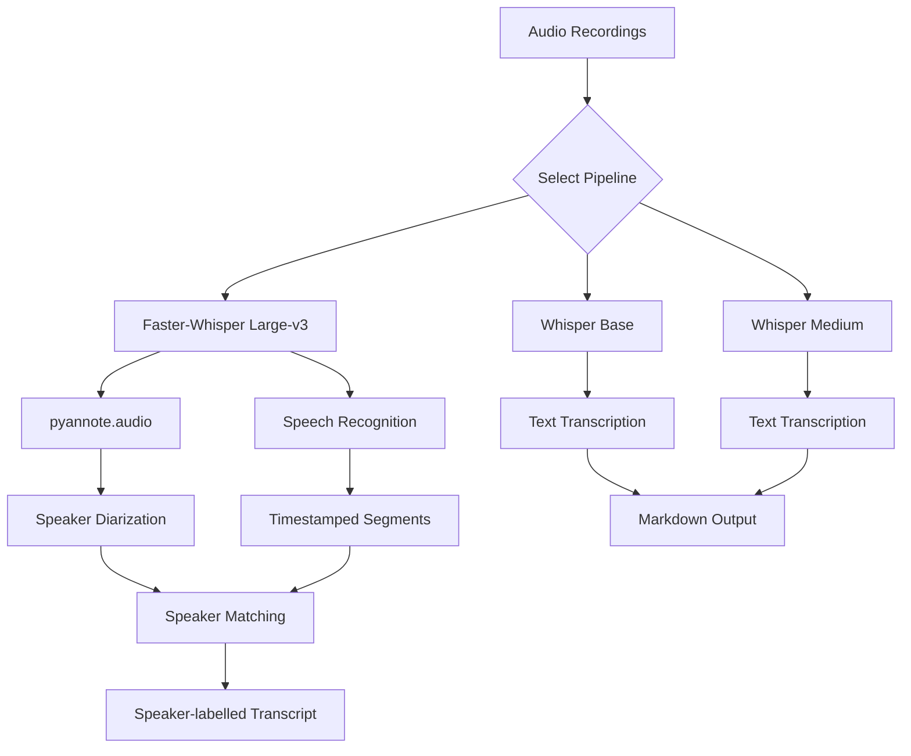

# 🎙️ Offline Speech-to-Text & Speaker Diarization

An AI-powered speech transcription system built with Python, OpenAI Whisper, Faster-Whisper, and pyannote.audio.

This project explores local speech recognition and speaker diarization to convert audio recordings into structured, readable text. It includes multiple transcription pipelines, GPU-accelerated inference, speaker identification, and an interactive Streamlit dashboard.

The goal is to build a flexible speech-processing workflow that can transcribe audio locally, reduce dependency on cloud-based transcription APIs, and generate organized transcripts for further analysis.

---

## ✨ Features

- **Offline Speech Recognition:** Transcribe audio using locally available Whisper models after downloading the required model weights.
- **Multiple Whisper Models:** Experiment with Base, Medium, and Large-v3 models.
- **GPU-Accelerated Transcription:** Use Faster-Whisper with CUDA for accelerated inference.
- **Speaker Diarization:** Integrate pyannote.audio to identify different speakers in an audio recording.
- **Timestamped Transcripts:** Generate speaker-labelled text segments with start and end timestamps.
- **Batch Audio Processing:** Process multiple recordings from a designated input directory.
- **Streamlit Dashboard:** Upload audio files and generate transcripts through a web interface.
- **Downloadable Results:** Export generated transcriptions as Markdown or plain-text files.

---

## 🧠 System Architecture

The project provides three different transcription workflows.

### 1. Whisper Base Transcription

Uses OpenAI Whisper Base to process audio recordings.

**Workflow:**
1. Read audio files from the `recordings/` directory.
2. Load the Whisper Base model.
3. Transcribe supported audio files.
4. Generate Markdown transcripts.
5. Save the results in `fwTXT/`.

### 2. Whisper Medium Transcription

Uses the Whisper Medium model for transcription.

This workflow follows a similar batch-processing approach but uses a larger model for speech recognition experimentation.

**Workflow:**
1. Load audio recordings from `recordings/`.
2. Initialize the Whisper Medium model.
3. Perform speech-to-text conversion.
4. Generate individual Markdown files.
5. Store the results in `mdTXT/`.

### 3. Faster-Whisper + Speaker Diarization

This pipeline combines Faster-Whisper Large-v3 with pyannote.audio.

It performs speech recognition and speaker diarization to generate structured transcripts.

**Workflow:**
1. Load the audio recording.
2. Run the pyannote.audio speaker diarization pipeline.
3. Transcribe the audio using Faster-Whisper Large-v3.
4. Enable VAD filtering to help handle non-speech portions.
5. Match transcription segments with diarization speaker turns.
6. Generate timestamped, speaker-labelled Markdown output.
7. Save the results in `dwTXT/`.

---

## 🔄 Processing Pipeline



---

## 🛠️ Technology Stack

| Technology | Purpose |
|---|---|
| Python | Core application development |
| OpenAI Whisper | Speech recognition |
| Faster-Whisper | Optimized Whisper inference |
| Whisper Large-v3 | High-capacity speech recognition |
| pyannote.audio | Speaker diarization |
| PyTorch | Deep learning framework |
| CUDA | GPU acceleration |
| Streamlit | Interactive transcription dashboard |
| Pathlib | File and directory management |

---

## 📁 Project Structure

```text
offline_Speech_To_Text/
│
├── recordings/
│   └── Audio files for transcription
│
├── fwTXT/
│   └── Whisper Base transcription outputs
│
├── mdTXT/
│   └── Whisper Medium transcription outputs
│
├── dwTXT/
│   └── Speaker-labelled transcription outputs
│
├── dashboard.py
│   └── Streamlit audio transcription dashboard
│
├── transcribe_faster_whisper.py
│   └── Faster-Whisper Base transcription pipeline
│
├── transcribe_medium.py
│   └── Whisper Medium transcription pipeline
│
├── transcribe_with_diarization.py
│   └── Faster-Whisper Large-v3 + pyannote pipeline
│
├── test_gpu.py
│   └── GPU environment verification
│
├── requirements.txt
│   └── Python dependencies
│
└── README.md
```

---

## ⚙️ Installation & Setup

### Prerequisites

- Python 3.10 or later (check compatibility with installed PyTorch and audio dependencies).
- Git.
- NVIDIA GPU with compatible CUDA support (recommended for GPU acceleration).
- NVIDIA drivers.
- Hugging Face account and access to the selected pyannote model for diarization.

### 1. Clone the Repository

```bash
git clone https://github.com/anujshandilya/offline_Speech_To_Text.git

cd offline_Speech_To_Text
```

### 2. Create a Virtual Environment

```bash
python -m venv venv
```

Activate it:

**Windows:**
```bash
venv\Scripts\activate
```

**Linux / macOS:**
```bash
source venv/bin/activate
```

### 3. Install Dependencies

```bash
python -m pip install --upgrade pip

pip install -r requirements.txt
```

**Note:** The Faster-Whisper and pyannote.audio scripts require their respective packages. Ensure `faster-whisper` and `pyannote.audio` are installed in the environment. GPU-enabled PyTorch must also match your CUDA environment.

### 4. Configure Hugging Face Access

The speaker diarization pipeline uses a pretrained pyannote model.

1. Create or sign in to your Hugging Face account.
2. Accept the applicable model access conditions.
3. Generate a Hugging Face access token.
4. Authenticate locally:

```bash
huggingface-cli login
```

This allows the diarization pipeline to access the model using your authenticated environment.

---

## 🚀 Usage

### Step 1: Prepare Audio Files

Create a directory named `recordings` in the project root and place your audio files inside it.

Supported formats include:

- WAV
- MP3
- M4A
- FLAC
- OGG
- WEBM (dashboard)

### Step 2: Run Whisper Base Transcription

```bash
python transcribe_faster_whisper.py
```

This script uses OpenAI Whisper Base and saves Markdown transcripts in `fwTXT/`.

### Step 3: Run Whisper Medium Transcription

```bash
python transcribe_medium.py
```

This uses the Whisper Medium model and saves outputs in `mdTXT/`.

### Step 4: Run Speaker Diarization

```bash
python transcribe_with_diarization.py
```

This executes the Faster-Whisper Large-v3 and pyannote.audio pipeline.

The output contains speaker labels and timestamps.

### Step 5: Launch the Streamlit Dashboard

```bash
streamlit run dashboard.py
```

Open the local Streamlit URL displayed in your terminal.

Upload an audio file, preview it, click **Transcribe Audio**, and download the generated transcript.

---

## 🗣️ Speaker Diarization Output

The diarization pipeline associates recognized speech segments with detected speaker labels.

Example output format:

```text
# Transcription with Diarization: sample_audio.mp3

SPEAKER_00 [0.50 → 3.20]
Hello, welcome to the meeting.

SPEAKER_01 [3.40 → 6.10]
Thank you. Let's get started.

SPEAKER_00 [6.50 → 9.80]
Today we will discuss the project.
```

*The above is an illustrative output format, not a benchmark or actual transcript.*

This structure makes transcripts easier to analyze when multiple people participate in a conversation.

---

## ⚡ GPU Acceleration

The Faster-Whisper pipeline is configured to use GPU inference.

Current configuration:

```python
whisper_model = WhisperModel(
    "large-v3",
    device="cuda",
    compute_type="int8_float16",
    cpu_threads=4,
    num_workers=1
)
```

This configuration uses:

- `large-v3`: Whisper model selection.
- `cuda`: NVIDIA GPU inference.
- `int8_float16`: Quantized computation configuration.
- `cpu_threads=4`: CPU thread configuration.
- `num_workers=1`: Worker configuration.

Actual performance depends on GPU hardware, available VRAM, drivers, and audio length.

---

## 🔐 Local Processing & Privacy

The project is designed around local speech-processing workflows.

- Audio transcription is performed using locally executed models.
- Model weights can be reused after initial download.
- Cloud transcription APIs are not required by the Whisper transcription scripts.
- The pyannote diarization model requires initial model access and download.
- Audio files are read from the local filesystem.

For fully disconnected execution, download and verify all required model weights and dependencies beforehand.

---

## 🎯 Project Objectives

The project focuses on exploring practical speech AI technologies:

- Understanding Automatic Speech Recognition (ASR).
- Experimenting with different Whisper model sizes.
- Comparing standard Whisper and Faster-Whisper workflows.
- Exploring GPU-based model inference.
- Implementing speaker diarization.
- Combining speech recognition with speaker identification.
- Generating structured and timestamped transcripts.
- Building an interactive interface for audio transcription.

---

## 🔮 Future Improvements

Potential enhancements include:

- Real-time speech transcription.
- Improved speaker-to-transcript alignment.
- Automatic language detection and multilingual transcription.
- Better handling of overlapping speech.
- Custom speaker naming and speaker mapping.
- Exporting transcripts into JSON, TXT, and SRT formats.
- Improved batch-processing and error handling.
- Integration with LLMs for transcript summarization and conversation analysis.
- Unified interface for selecting transcription models and processing pipelines.

---

## 👨‍💻 Author

**Anuj Shandilya**

AI / Generative AI Enthusiast | Python Developer

- GitHub: [@anujshandilya](https://github.com/anujshandilya)
- Repository: [Offline Speech-to-Text](https://github.com/anujshandilya/offline_Speech_To_Text)

---

## 📄 License

A license has not yet been specified for this repository.
